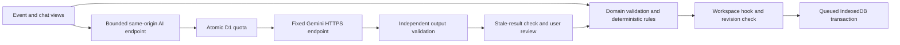

# Architecture and maintenance

Gather separates event rules, browser persistence, presentation, and the external AI boundary. Event records remain browser-local; D1 holds only the shared AI quota. No new runtime dependency was added in the maintainability release.

## Module responsibilities

| Module | Responsibility |
| --- | --- |
| `app/planner/planner.tsx` | Compose the workspace, select dialogs and handle event navigation |
| `use-event-workspace.ts` | Load records, queue writes, advance revisions, import/delete events and report persistence failures |
| `event-view.tsx`, section components | Present one event and manage its view filters |
| `use-personalization.ts` | Own one cancellable generation request and reject responses for a changed event |
| `use-conversation.ts` | Send bounded chat context and append a validated exchange |
| `use-proposal-review.ts` | Preview and apply changes only against the matching event revision |
| `chat-message.tsx`, `chat-preview.tsx`, `chat-composer.tsx` | Render conversation, change review and user input separately |
| `domain/` | Validate records and implement exact money, templates, dates, task dependencies, scenarios and chat proposals |
| `storage/repository.ts` | Enforce IndexedDB transactions, stale-write detection and validated backup import |
| `storage/write-queue.ts` | Preserve ordered writes and block an event's pending/future writes after a failed base revision until reload |
| `server/` | Enforce request boundaries, durable quotas, provider timeouts and structured AI response validation |
| `lib/ai-response.ts` | Narrow unknown response JSON before the client reads it |
| `app/styles/` | Keep base, workspace, event, dialog, responsive, accessibility and chat styling in explicit cascade order |

## Data flow

Scenario comparisons make no AI request. Personalization requires confirmation; chat requires Send, and a proposal additionally requires Preview and Apply. Neither AI path writes directly to storage or changes paid amounts. The existing security controls and integer money arithmetic remain in place.

## Guardrails

`npm run verify` runs strict TypeScript, zero-warning lint, formatting checks, and scoped coverage tests. Application TypeScript modules have a 300-line limit, functions a 240-line limit, cyclomatic complexity a limit of 15, and nesting a limit of four. Non-null assertions are rejected. These are maintenance limits rather than a proof of correctness.

Coverage gates require 100% lines, statements and functions and at least 97% branches across domain, server, storage, exports, and the shared client response boundary. React hooks and interactions are checked through browser journeys; these are not included in the scoped coverage percentage. Browser tests cover successful flows, API/storage failures, legacy backups, conflicting tabs, mobile layout, keyboard focus, forced colors and automated accessibility scans.

Run browser tests against a running development or built Worker preview. After changing an event rule, add a focused domain test; after changing persistence or interaction, add a browser regression test for the user-visible failure. Tests must use fictional data and mock provider requests except during a deliberate live smoke check.

## Compatibility and release

Backups retain format version 1. Records created before chat receive an empty conversation through schema defaults. Imports create new event IDs and preserve the original records. Stylesheet extraction preserves cascade order; the accessibility changes enlarge controls and add error/focus semantics.

Persistence supplies an explicit expected base revision on each write. A higher local counter alone does not authorize overwriting a different saved version. Failure blocks that event's write queue and the editing controls while leaving an unsaved-copy backup and reload available. A new workspace after reload uses the current saved snapshot. Exact duplicate retries remain safe, and missing saved records cannot be silently resurrected by a stale edit.

The public GitHub workflow uses the pinned compatible Ubuntu runner and locked dependency installation. A release must pass typecheck, lint, formatting, unit/integration tests, audit, build and browser tests before the competition entry is updated. Publishing a release does not submit another competition attempt or establish a new evaluation score.
